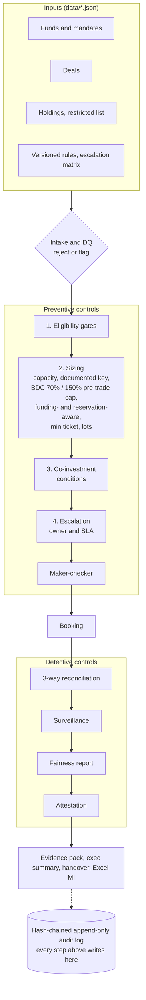

# private-credit-allocation-engine

A solution accelerator prototype (personal build) for an end-to-end **multi-fund private-credit investment allocation** process with the controls an allocations function is accountable for. A deal goes through eligibility gates, documented sizing, co-investment conditions, maker-checker approval, booking, three-way reconciliation and portfolio surveillance. Every step is written to a tamper-evident audit log, and one command produces the evidence an auditor would ask for.

> **Disclaimer.** Personal build: a solution accelerator prototype, not a production system. All data is synthetic. All policies are *illustrative*, modelled on public information (a BDC's annual report and a publicly filed SEC co-investment exemptive application). Nothing here represents any firm's actual policies, systems, data or views.
>
> **Regulatory boundary.** The BDC checks (70% qualifying assets, 150% asset coverage, funding scenarios) are a **model under stated assumptions** – simplified book-value balance sheet, cash treated as qualifying, illustrative classifications. They are not legal advice and not a production-ready regulatory control. Classification and the calculation basis would need validation against authoritative guidance and by the fund's Legal and Compliance teams before any real use.

## Walkthrough (2 min, synthetic data)

https://github.com/user-attachments/assets/922c1c92-f02d-47d9-b03b-efa1113f0658

**Python 3.11+ · SQLite · pydantic · openpyxl · pytest (80 tests) · no external services**

---

## Architecture



Preventive controls (intake → maker-checker) stop a bad allocation before it is booked. Detective controls (reconciliation, surveillance, attestation) re-check what actually happened downstream. Design decisions are recorded in [docs/adr](docs/adr).

## Quickstart (Windows PowerShell; on macOS/Linux use `source .venv/bin/activate`)

```
python -m venv .venv
.venv\Scripts\activate
pip install -e ".[dev]"
pytest                                    # 80 passed

python -m alloc load --reset              # 6 funds, 13 deals; D007 flagged (missing rating)
python -m alloc demo                      # all six mock cases end to end, prints the numbers
python -m alloc evidence --run R0004      # audit evidence for one allocation
python -m alloc exec-summary              # one-page status for management
python -m alloc handover --from Bengaluru --to "New York"
python -m alloc fairness                  # fair share vs actual per fund across all final allocations
python -m alloc reservations              # capital and BDC headroom held by live, unbooked runs; owner, age, review-by
python -m alloc decisions                 # operator decision pack: what, who, by when, evidence
python -m alloc decisions --days-ahead 4  # preview: reservations needing renew-or-release
python -m alloc attest --period 2026-10 --by cco1
python -m alloc export --out allocation_report.xlsx
python -m alloc audit verify
```

Step-by-step commands for each stage are in the build guides (below) and `python -m alloc --help`.

## Mock cases (results in [docs/FINDINGS.md](docs/FINDINGS.md))

| # | Deal | What it shows | Result |
|---|---|---|---|
| 1 | D003 Atlas, $400m | Concentration headroom binds; two BDCs already hold the issuer; two sizing keys compared | Board-step condition triggered, resolved by a proportional rebalance (F1:F2 = 72:28, matching existing holdings); self-approval refused; a $0.5m ledger break caught and resolved |
| 2 | D009 Crescent, $220m | Issuer restricted for the insurance mandate only | F5 excluded with `RESTRICTED_ISSUER`; other five funds allocated; reconciles clean |
| 3 | D007 Bluebell, $110m | Missing rating | Blocked at intake → corrected with a sourced reason → allocated, approved, booked |
| 4 | D008 Summit, $300m | Non-qualifying asset into BDCs, funding-aware | F2 (debt-funded) capped at 57.5, not 60, staying at 70.006%; cash-funded the limit would be 40.0. v0.5 without the check breached at 69.94% |
| 6 | D013 Orion, $120m | Two non-qualifying deals in flight; funding unknown | D008 (approved, not booked) reserves F2's headroom, so F2 gets 0; F1 funding unknown → conservative case + High exception to Compliance – a hard stop: approval refused and booking blocked until funding is confirmed or the run is rejected / released |
| 5 | D010 Meridian, $75m | Follow-the-sun | Run submitted in Bengaluru appears in the New York handover, with SLA clocks |
| – | All final allocations | Fairness across the deal set | Fair share vs actual per fund with reason codes; F2 −4.49% explained by the D003 rebalance and the D008 regulatory cap; signed off by a reviewer who is not a maker; the sign-off is bound to run set, tolerance, policy versions and report hash |

## How the role's responsibilities map to the build

| Responsibility of an allocations function | Where |
|---|---|
| Hypothetical allocation scenarios, finalise accurately | `run --mode hypo`, `compare`, `rebalance`, `promote`, `withdraw` |
| Intake, eligibility, constraints, exceptions, approvals, booking, post-allocation review | `intake.py`, `allocate.py`, `workflow.py`, `ops.py` |
| Policies, restrictions, conflicts protocols, regulatory requirements | `data/rules.json` (versioned, typed), restricted list, co-investment conditions, BDC surveillance tests |
| Maker-checker, documented approvals, audit trails, escalation, control attestations | `workflow.py`, `audit.py`, `data/escalation.json`, hard stops that approval cannot clear, `attest` (13 tests) |
| KRIs, KPIs, service-level metrics | `metrics`, Excel report, SLA due times on every exception and every submitted run, reservation aging |
| Surveillance, portfolio reviews, management reporting | `surveil`, `fairness`, `exec-summary`, `export` |
| Data quality and reconciliation across systems | intake DQ, `correct-deal`, three-way `reconcile`, `resolve-break` |
| Follow-the-sun handover, procedures, BCP | `handover`, [docs/RUNBOOK.md](docs/RUNBOOK.md) |
| Ad hoc analysis | `queries/*.sql` via `python -m alloc sql` |
| Audit and regulatory evidence | `evidence --run <id>`, `audit verify`, `audit trail --entity <id>` |
| Concise executive updates and decisions | `exec-summary`, `decisions` (owner, deadline, evidence per decision) |
| Requirements, testing, change control | [docs/SPEC.md](docs/SPEC.md), 80 pytest tests, build guides |

## Repository

```
src/alloc/      intake, ratings, allocate, workflow, audit, ops, reports, CLI
data/           synthetic funds, deals, holdings, restricted list, rules, escalation matrix
queries/        SQL pack for typical ad hoc questions
tests/          80 tests: maths, gates, conditions, controls, reconciliation, reports, end-to-end demo
docs/           SPEC, FINDINGS, RUNBOOK, ADRs 0001–0007, build guides B01–B07 (B07 includes the B07.1 control fixes)
```

## Build guides

[B01 intake and DQ](docs/B01_GUIDE.md) · [B02 eligibility, sizing, co-investment](docs/B02_GUIDE.md) · [B03 maker-checker and audit log](docs/B03_GUIDE.md) · [B04 booking, reconciliation, surveillance](docs/B04_GUIDE.md) · [B05 mock cases and evidence](docs/B05_GUIDE.md) · [B06 pre-trade headroom and fairness](docs/B06_GUIDE.md) · [B07 funding, reservations, sign-off, decision pack; B07.1 control fixes](docs/B07_GUIDE.md)

## Limitations

Prototype scope: single-currency, issuer-level holdings ("same security" approximated by "same issuer"), simplified BDC balance sheet, no pricing or valuation, no UI, no live integrations. See [docs/FINDINGS.md](docs/FINDINGS.md#limitations-and-next-steps).

## Licence

MIT – see [LICENSE](LICENSE).
