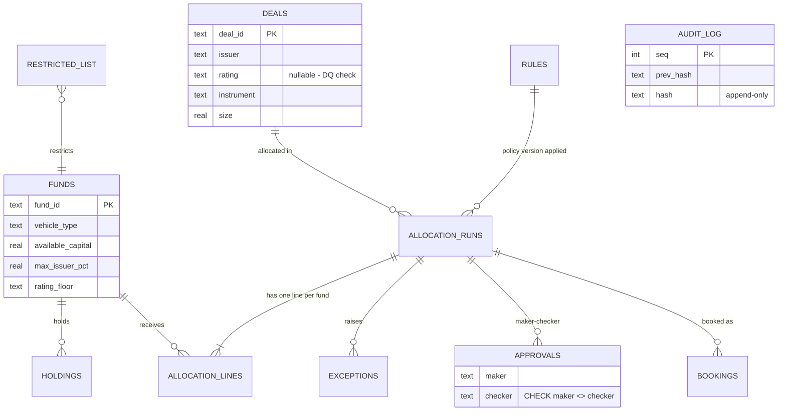
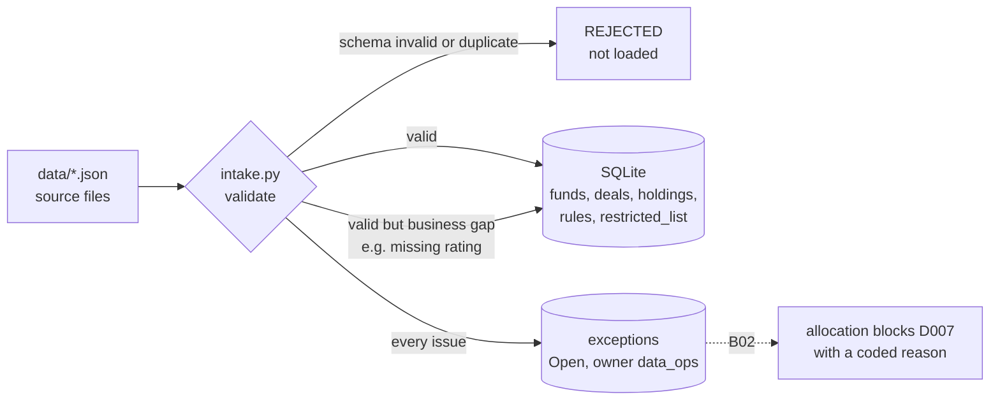

# B01 Guide – Scaffold, synthetic data and data-quality intake

**Date:** 19 Oct 2026
**Starting point:** empty repo; spec approved (`docs/SPEC.md` v0.1), with every responsibility of a typical investment-allocations function mapped to a feature.
**B01 goal:** a working foundation for the allocation engine. That means a database whose controls are enforced in the schema itself, realistic synthetic data with test conditions planted on purpose, and an intake layer where every record is validated before the engine uses it and nothing bad is ever silently dropped.

---

## Step 1 – Write the spec before any code
**What:** `docs/SPEC.md` maps each of 15 allocations-function responsibilities (R1–R15) to a feature: hypos, eligibility, constraints, exceptions, maker-checker, audit trail, reconciliation, surveillance, KPIs/KRIs, evidence pack, and so on. It also defines the data model, the pipeline, 3 mock cases and a definition of done.
**Decisions taken at review:**
- **Pro-rata:** available capital is the default; target weight runs as a hypo variant, so the two policies can be compared side by side.
- **Data size:** 6 funds and 12 deals, enough to exercise every rule while keeping results checkable by hand.
- **Repo:** a standalone repo.

**Why:** build against requirements rather than ideas. Every later feature traces back to a stated requirement.
**Committed:** `docs/SPEC.md` (Build 00).

## Step 2 – Database schema with controls built in
**What:** `src/alloc/schema.sql` creates 12 tables:

| Table | Purpose | Requirement |
|---|---|---|
| funds, deals, holdings, restricted_list | Reference and position data | R2, R3 |
| rules | Versioned policy rulebook | R3, R15 |
| allocation_runs, allocation_lines | Each hypo or live run and its per-fund result | R1, R2 |
| exceptions | Exception queue (severity, owner, status) | R2, R5 |
| approvals | Maker-checker record | R4 |
| bookings, ledger_stub | Booking file and a simulated downstream system | R2, R7 |
| audit_log | Append-only, hash-chained log | R4, R15 |


**Data model (entity-relationship diagram):**



**Controls enforced by the database, not just the code:**
```sql
CHECK (maker <> checker)                      -- nobody approves their own allocation
CHECK (max_issuer_pct > 0 AND max_issuer_pct <= 1)
CHECK (severity IN ('Low','Medium','High','Critical'))
```
**Why:** defence in depth. A bug in the Python code, or a direct edit to the data, still can't bypass maker-checker.
**Result:** `test_maker_cannot_be_checker` shows the database refuses a self-approval.
**Committed:** `schema.sql`, `db.py`, `tests/test_schema.py` (Build 00, 2/2 tests).

## Step 3 – Fix the environment
**Issues:**
- PowerShell blocked the virtual-environment activation script.
- The zip unzipped into a nested folder, so pip couldn't find `pyproject.toml`.

**Fixes:**
```powershell
Set-ExecutionPolicy -Scope CurrentUser -ExecutionPolicy RemoteSigned
# flatten private-credit-allocation-engine\private-credit-allocation-engine → one level, then:
python -m venv .venv; .venv\Scripts\activate; pip install -e ".[dev]"
```
Also added `*.egg-info/` to `.gitignore` before the first commit.
**Result:** 2/2 tests pass. Build 00 is pushed to a **private** GitHub repo, and `git log --all --oneline -- .env` prints nothing.

## Step 4 – Synthetic data, with test conditions planted on purpose
**What:** the `data/*.json` files hold 6 funds, 12 deals, 5 holdings, 1 restricted-list entry and 10 versioned rules (USD millions, all invented).

| Fund | Type | Capital | Issuer cap (of NAV) | Rating floor | Excluded / instruments |
|---|---|---|---|---|---|
| F1 | BDC | 300 | 5% of 6,000 = 300 | B- | – |
| F2 | BDC | 150 | 5% of 2,500 = 125 | B | Energy |
| F3 | Drawdown | 400 | 8% of 5,000 = 400 | CCC+ | – |
| F4 | Drawdown | 120 | 6% of 1,500 = 90 | B | Gaming; first lien or unitranche only |
| F5 | Insurance SMA | 200 | 3% of 4,000 = 120 | BB- | Energy, Gaming; first lien only |
| F6 | Evergreen | 80 | 4% of 1,200 = 48 | B- | – |

**Planted conditions, one per mock case:**

| Deal | Condition | Will prove |
|---|---|---|
| D003 Atlas, $400m | F1 already holds $280m, leaving **$20m** headroom; F2 holds $110m, leaving **$15m** | Concentration caps bind, and the excess must be redistributed |
| D009 Crescent | Restricted **for F5 only** | Restrictions apply per fund, not firm-wide |
| D007 Bluebell | `rating: null` | Data-quality exception at intake, so the deal is blocked from allocation |

**Design choice:** limits differ by vehicle because mandates differ. Insurance capital is the most conservative (BB- floor, first lien only, 3% cap), while the drawdown fund F3 can take CCC+. As a result, eligibility genuinely varies by fund, which is the core of an allocations job.

## Step 5 – Intake and data-quality validation
**What:** `src/alloc/intake.py` uses pydantic models for `Fund` and `Deal`, plus `ratings.py` for the rating scale (AAA = 0 … CCC- = 18) and a `meets_floor()` check.

| Check | Catches | Result |
|---|---|---|
| Required fields, allowed values | missing issuer, vehicle type "hedge", instrument "equity" | **Rejected** |
| Numeric sanity | size ≤ 0, negative capital, issuer cap > 100% | **Rejected** |
| Rating on scale | rating "Z" | **Rejected** |
| Duplicate ID | a second D001 | **Rejected** |
| Missing rating | D007 | **Loaded + High exception**, blocked from allocation |


**Data flow at intake:**



Every issue becomes a `DQIssue` (entity, ID, code, severity, message, whether it blocked the record) and is written to the `exceptions` table with status **Open** and owner **data_ops**.

**Design choice:** structurally broken data is rejected, because loading it would corrupt everything downstream. A *business* gap is loaded but flagged, because silently dropping a real deal hides it from the team and breaks the audit trail. The flag means it gets an owner, is blocked with a reason, and gets resolved.
**CLI:** `python -m alloc load --db alloc.db --data data`
**Result:**
```
Loaded: funds=6, deals=12, holdings=5, restricted_list=1, rules=10, exceptions=1
  DQ High     deal D007: MISSING_RATING – rating missing; deal loaded but blocked from allocation until resolved
```
**Known limitation:** re-running `load` on the same database hits duplicate keys, so delete `alloc.db` first for now. A `--reset` flag comes in B02.

## Step 6 – Tests

| Test | Proves |
|---|---|
| test_schema_creates_all_tables | All 12 tables exist |
| test_maker_cannot_be_checker | The database refuses self-approval |
| test_seed_loads_expected_counts_and_flags_only_missing_rating | Loads 6 / 12 / 5 / 1; **exactly one** DQ issue (D007), stored as an Open High exception |
| test_duplicate_deal_id_rejected | Duplicates caught |
| test_non_positive_size_rejected | Size ≤ 0 caught |
| test_rating_off_scale_rejected | Invalid rating caught |
| test_unknown_vehicle_type_rejected | Unknown fund type caught |
| test_issuer_cap_above_100pct_rejected | Impossible limit caught |
| test_rating_floor_comparison | Better / equal / worse than the floor all handled |

**Result:** **9/9 passed.**
**To commit:** `data/`, `ratings.py`, `intake.py`, `__main__.py`, `tests/test_intake.py`, this guide. Message: `Build 01: synthetic data, intake and DQ validation`.

---

## B01 scorecard
| Item | Status |
|---|---|
| Responsibilities mapped to features | 15 / 15 |
| Tables | 12, with maker ≠ checker enforced in the schema |
| Synthetic data | 6 funds (4 vehicle types), 12 deals, 3 planted conditions |
| DQ checks | 6 types; reject vs flag-and-block |
| Tests | 9 / 9 |
| Exceptions raised on seed | 1 (D007, High, Open, owner data_ops) |

## Lessons
1. **Spec before code:** every feature traces to a requirement, so nothing is built that a reviewer won't care about.
2. **Put critical controls in the database:** a schema constraint can't be bypassed by an application bug.
3. **Plant your test conditions:** synthetic data should be designed so that every control is provably exercised.
4. **Reject or flag, never silently drop:** structural errors are rejected, business gaps are flagged, owned and blocked.
5. **Check the environment before the logic:** two setup issues (execution policy, nested folder) cost more time than the code did.

## Next (B02)
- Eligibility per fund: asset class, instrument, rating floor, sector exclusions, restricted list, each failure with a coded reason.
- Pro-rata by available capital (default) and by target weight (hypo variant).
- Constraints: issuer cap, minimum ticket, lot rounding, and redistribution until stable.
- An exception for every breach, plus a `--reset` flag for `load`.
