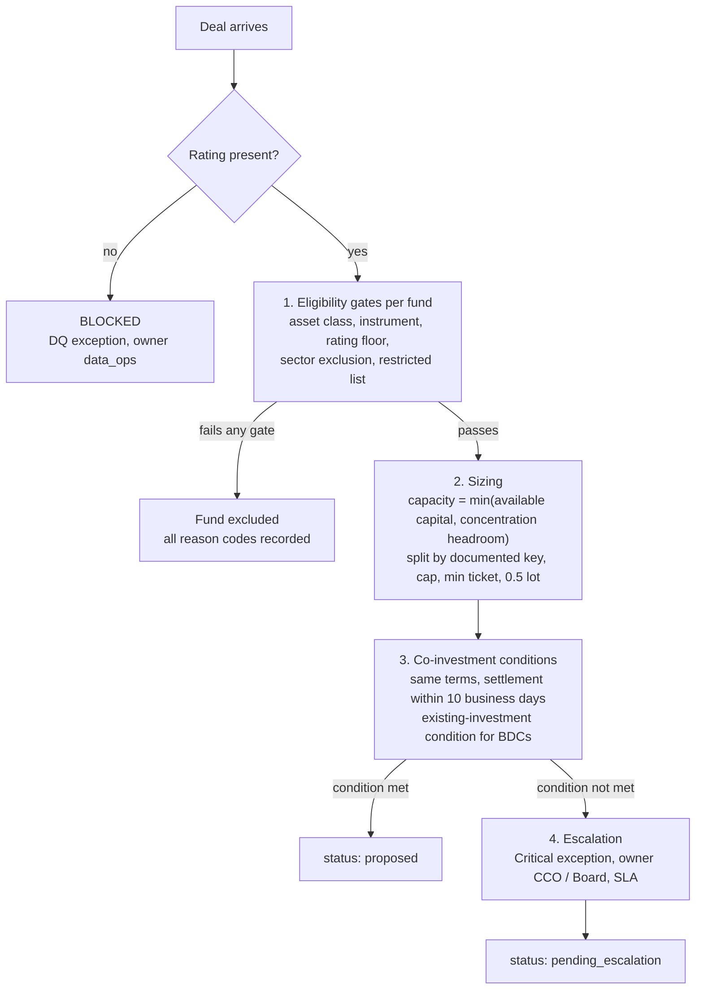
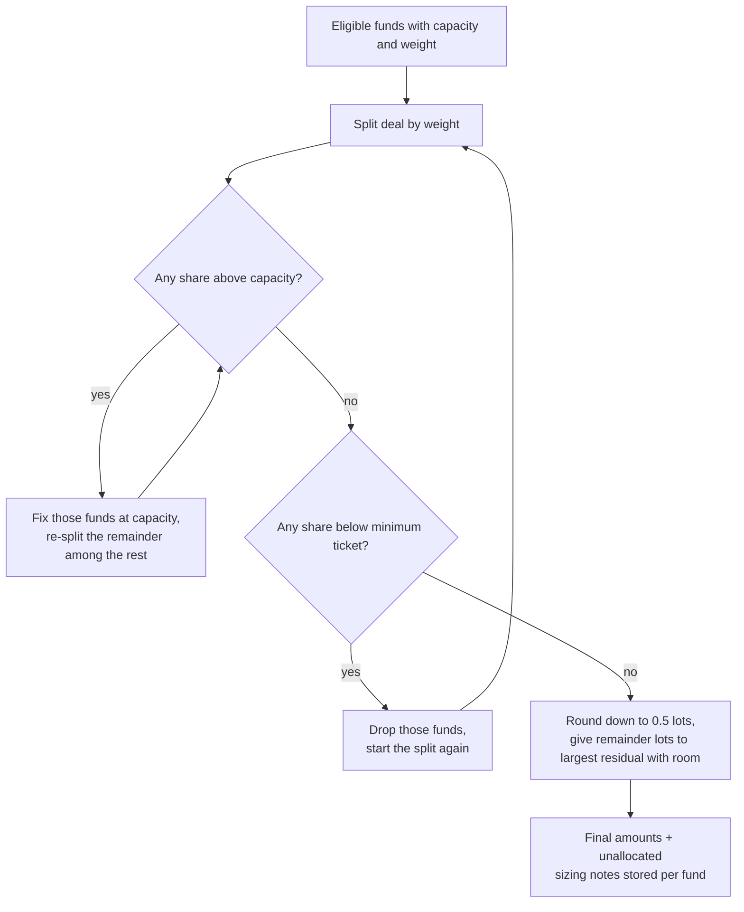

# B02 Guide – Eligibility, sizing, co-investment conditions and escalation

**Date:** 19 Oct 2026
**Starting point (B01):** schema with maker ≠ checker enforced, synthetic data for 6 funds and 12 deals, intake with data-quality checks. 9/9 tests.
**B02 goal:** turn a deal into a proposed allocation the way an allocations team would. That means hard eligibility gates, documented multi-factor sizing, the co-investment conditions, and an owned escalation for every exception, all grounded in what a BDC's 10-K and its publicly filed co-investment application actually say.

---

## Architecture – four separate decisions

**Pipeline for one deal (allocate.py → run_allocation):**



---

## Step 1 – Primary-source research before building
**What:** read the BCRED FY2025 10-K and the 2025 co-investment application (SEC file 812-15726, order IC-35644 of 18 Jun 2025) and answered 6 questions:

| Question | Finding | Engine consequence |
|---|---|---|
| Which vehicles share deals? | The BDC alongside the adviser's other funds, accounts and co-investors, subject to mandate and allocation policy; the order covers named regulated funds plus affiliates | Funds carry a vehicle type; BDCs are treated as regulated funds |
| What sets each share? | **Multi-factor, good-faith** allocation (mandate fit, capital, leverage, existing positions/concentration, liquidity, size/minimums, legal limits, timing) – **not universal pro rata** | Sizing is separate from eligibility; the allocation key is documented per run |
| What makes a fund ineligible? | Mandate, guidelines, restrictions, contractual and legal limits = hard gates. Capital, concentration and size **reduce** a share | Gates exclude; capacity limits reduce |
| What does "same terms" require? | Same class, price and timing (plus rights); settlement may differ by up to **10 business days** | `COINV-SAME-TERMS` check |
| When is the board step needed? | An affiliate already holds the issuer – **unless** the fund already holds the same security and it and each affiliate holder participate in approximate proportion | `COINV-EXISTING-INVESTMENT` check |
| BDC limits? | **70% qualifying assets**; **150% asset coverage** – portfolio-level, not per-deal % | Moved to B04 surveillance |

**Why:** the first design (spec v0.1) used "pro rata by available capital" as the default rule and treated board approval as needed whenever an affiliate held the issuer. The sources showed both were too simple.
**Result:** spec updated to **v0.2**, with four separate decisions (§4) and decisions 1, 4 and 5 recorded (§12).

## Step 2 – Rules rebuilt around the four decisions
**What:** `data/rules.json` now has 12 versioned rules, typed as:
- `eligibility_gate` – asset class, instruments (F4, F5), rating floor, sector exclusions, restricted list
- `sizing` – `SIZE-KEY` (default `capacity`, alternative `target_weight`), `SIZE-CONC-HEADROOM`, `SIZE-MIN-TICKET`, `SIZE-LOT` (0.5)
- `coinvestment_condition` – `COINV-SAME-TERMS` (10 business days), `COINV-EXISTING-INVESTMENT` (BDCs, ±10% proportion tolerance)

Plus `data/escalation.json`: severity → owner + SLA (Low analyst 24h · Medium VP 8h · High VP + CCO 4h · Critical CCO / Board 1h).
**Design choice:** concentration is a **sizing** rule, not an eligibility gate. That matches the 10-K: existing positions reduce a share; they don't disqualify the fund.

## Step 3 – Eligibility gates (`allocate.py → check_eligibility`)
Returns **every** failed gate, not just the first, so the reason is complete for audit:

| Deal | Fund | Reasons |
|---|---|---|
| D001 (B, unitranche) | F5 | `INSTRUMENT_NOT_PERMITTED; BELOW_RATING_FLOOR` |
| D004 (Energy) | F2, F5 | `SECTOR_EXCLUDED` |
| D009 (Crescent) | F5 | `RESTRICTED_ISSUER` (date-valid, this fund only) |
| D011 (CCC+, second lien) | all except F3 | rating floor and/or instrument |

A deal with a missing rating (D007) is **blocked before eligibility**: no allocation at all, status `blocked`, exception owned by data_ops.

## Step 4 – Sizing (`size_allocation`)
**What:**
1. Capacity per eligible fund = **min(available capital, issuer-cap headroom)**, where headroom = max_issuer_pct × NAV − existing exposure.
2. Split the deal by the documented key (`capacity` or `target_weight`).
3. A share above capacity is **capped**, and the excess is re-split among the others; repeat until stable.
4. A share below the fund's **minimum ticket** is dropped, and the deal is re-split.
5. Round down to **0.5 lots**; the rounding remainder goes one lot at a time to the fund with the largest residual that still has capacity.
6. Anything that can't be placed is reported as **unallocated**, never hidden.


**Sizing algorithm (size_allocation):**



Every fund gets **sizing notes** (`CAPACITY_SET_BY_CONCENTRATION_LIMIT`, `CAPPED_AT_CAPACITY`, `SHARE_BELOW_MIN_TICKET`, …) stored on the allocation line, so the rationale for each number is on record.

**Result – D003 hypo comparison (`python -m alloc compare --deal D003`):**

| Fund | Capacity | Capacity key | Target-weight key |
|---|---|---|---|
| F1 | 20 (headroom) | 11.5 | **20 (capped)** |
| F2 | 15 (headroom) | 8.5 | **15 (capped)** |
| F3 | 400 | 231 | 182.5 |
| F4 | 90 | 52 | 61 |
| F5 | 120 | 69.5 | 91 |
| F6 | 48 | 27.5 | 30.5 |
| Total | | 400 | 400 |

Under the target-weight key, F1 and F2 hit their concentration headroom and the excess is redistributed. That's exactly why the key is a documented, comparable choice and not a hidden default.

## Step 5 – Co-investment condition checks
**Same terms:** all participants share the deal's instrument and price; settlement dates must sit within 10 business days. Tested with a 10-day pass and a 15-day fail, and through a settlement override on a real run, which raises a **Critical** exception.

**Existing investment (BDCs only):**

| Deal | Affiliate holders | Outcome |
|---|---|---|
| D003 Atlas | F1 (280), F2 (110) → 72% / 28% | Allocations 11.5 / 8.5 = 57% / 43%; outside ±10% → **board step for F1 and F2** (`NOT_IN_PROPORTION_TO_EXISTING_HOLDINGS`) |
| D001 / D012 Northwind | F3 (drawdown) | F1 and F2 participate without holding → **board step** (`AFFILIATE_HOLDS_ISSUER_FUND_DOES_NOT`); F6 is not a BDC, so not flagged |
| D010 Meridian | none | No condition triggered → status `proposed` |

**Design choice:** this check flags; it does not change amounts. Deciding whether to rebalance into proportion or to seek the board step is a human decision, so it goes to escalation (and, in B03, maker-checker).
**Known simplification:** holdings are at issuer level, so "same security" is approximated by "same issuer". This is documented in the rule.

## Step 6 – Persisting the run and the CLI
**What:** every run writes:
- `allocation_runs`: mode (hypo/live), **allocation key**, **policy version string** (every rule@version), unallocated, status.
- `allocation_lines`: eligible, reasons, capacity, weight, proposed and final amounts, sizing notes.
- `exceptions`: severity, owner, detail.

Schema → **v0.2** (added `allocation_key`, `unallocated`, `capacity`, `weight`, `sizing_notes`, `detail`).

```
python -m alloc load --reset --db alloc.db --data data
python -m alloc run --deal D003 --mode hypo
python -m alloc compare --deal D003
```
**Fixed from B01:** `load --reset` removes the known re-run limitation.

## Step 7 – Tests
17 new tests (26 total):
- **Gates:** D011 (only F3, takes 40), D009 (F5 only), D004 (sector), D007 (blocked, owner data_ops).
- **Co-investment:** D003 (not in proportion), D001 (holder vs non-holder), D010 (clean), a proportional unit case with a holder sitting out, the same-terms window, a settlement override.
- **Sizing:** cap and redistribute, minimum-ticket drop, undersubscribed, the two keys differ.
- **Invariants, every deal × both keys:** every dollar accounted for (allocated + unallocated = size); no ineligible fund allocated; nothing above capacity; nothing below minimum ticket; 0.5 lots.
- **Persistence:** the run is stored with its key and policy version.

**Result:** **26/26 passed.**
**To commit:** `src/alloc/allocate.py`, `src/alloc/__main__.py`, `src/alloc/schema.sql`, `data/rules.json`, `data/escalation.json`, `data/README.md`, `tests/test_allocate.py`, `tests/test_schema.py`, `docs/SPEC.md`, `docs/B02_GUIDE.md`. Message: `Build 02: eligibility gates, documented sizing, co-investment conditions, escalation`.

---

## B02 scorecard
| Item | B01 | B02 |
|---|---|---|
| Rules | 10 | 12 (typed: gate / sizing / co-investment condition) |
| Pipeline decisions implemented | intake | intake + eligibility + sizing + co-investment + escalation |
| Hypo comparison | – | 2 documented keys, side by side |
| Exceptions with owner + SLA | DQ only | DQ, unallocated, no eligible fund, same terms, existing investment |
| Tests | 9 | 26 (incl. invariants on all deals × both keys) |
| Spec | v0.1 | v0.2 (research-driven) |

## Lessons
1. **Read the primary source before encoding policy:** the 10-K and the application overturned two assumptions (pro rata as default; board approval whenever an affiliate holds).
2. **Separate decisions that look alike:** "can this fund take it?" (gate), "how much?" (sizing) and "does this need sign-off?" (condition) fail for different reasons and have different owners.
3. **Flag, don't silently fix:** the engine shows the condition breach; a human chooses whether to rebalance or escalate.
4. **Test invariants, not just examples:** one parametrised test checks every deal under both keys.
5. **Every number needs a reason on record:** sizing notes and the policy version make any allocation explainable to an auditor.

## Next (B03)
- Maker-checker workflow on runs (submit → approve or reject, with rationale on overrides).
- Hash-chained, append-only audit log with a `verify` command.
- Escalation tracking (SLA clock, status transitions); `promote` a hypo to live.
