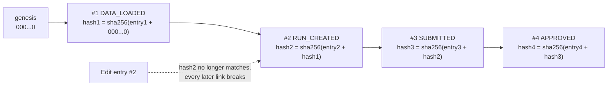
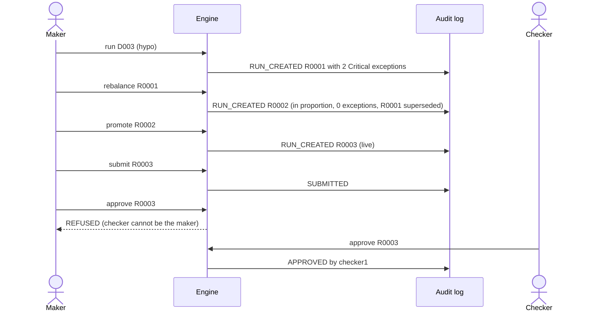

# B03 Guide – Maker-checker, hash-chained audit log, proportional rebalance

**Date:** 19 Oct 2026
**Starting point (B02):** eligibility gates, documented sizing, co-investment checks and escalation; runs are stored with key and policy version. 26/26 tests.
**B03 goal:** governance an allocations function is accountable for – *"maker-checker controls, documented approvals, audit trails, escalation protocols"* and *"complete and readily retrievable evidence"* – plus a way to resolve the D003 co-investment problem by judgement rather than by silently changing numbers.

---

## Step 1 – Hash-chained, append-only audit log (`audit.py`)
**What:** every action writes one entry: timestamp, actor, action, entity, payload (JSON), the **previous entry's hash**, and its own SHA-256 hash.
```python
h = sha256(canonical_json(ts, actor, action, entity, payload, prev_hash))
```
Two independent layers:
1. **Database triggers** refuse any `UPDATE` or `DELETE` on `audit_log` → *"audit_log is append-only"*.
2. **Hash chain**: change any past entry and its hash no longer matches, and every later link breaks. `python -m alloc audit verify` reports the first broken entry.


**How the hash chain detects tampering:**



**What gets logged:** `DATA_LOADED` (counts, DQ issues, and a fingerprint of every input file), `RUN_CREATED` (key, policy version, final amounts, exceptions raised, exceptions superseded), `SUBMITTED`, `APPROVED`, `REJECTED`.
**Result:** tamper test – blocked by the trigger; then, after deliberately dropping the trigger (simulating a privileged user) and editing one amount, `verify` → **"AUDIT CHAIN BROKEN at entry 2"**.
**Why:** an auditor or regulator can trust the trail without trusting whoever administers the database.

## Step 2 – Maker-checker workflow (`workflow.py`)

| Transition | Who | Rule |
|---|---|---|
| live run → `submitted` | the **maker** who created it | Hypo runs can't be submitted ("promote first") |
| `submitted` → `approved` | a **checker ≠ maker** | Open High/Critical exceptions need a **rationale**, recorded as their resolution |
| `submitted` → `rejected` | a checker ≠ maker | Rationale mandatory |


**Run lifecycle (state diagram):**

```mermaid
stateDiagram-v2
    [*] --> hypo : run --mode hypo
    hypo --> hypo_rebalanced : rebalance
    hypo --> live : promote
    hypo_rebalanced --> live : promote
    [*] --> live : run --mode live
    live --> submitted : submit (maker only)
    submitted --> approved : approve (checker is not maker; rationale if High or Critical open)
    submitted --> rejected : reject (checker, rationale)
    approved --> [*]
    rejected --> [*]
```



**Defence in depth:** maker ≠ checker is checked in Python *and* by the `CHECK (maker <> checker)` constraint from B00.
**Result (actual run):**
```
approve --run R0003 --by maker1   → REFUSED: maker-checker: the checker cannot be the maker
approve --run R0004 --by checker1 → REFUSED: open High/Critical exceptions ['E0004','E0005'] – approval needs a rationale
approve --run R0004 --by checker1 --rationale "Board step obtained ... (illustrative)"
                                  → approved; resolved exceptions ['E0004','E0005']
```

## Step 3 – Proportional rebalance (judgement, not silent fixing)
**Problem from B02:** in D003, F1 and F2 already hold Atlas (280 : 110 = 72% / 28%) but would participate 57% / 43% → board step needed.
**What:** `rebalance --run R0001` creates a **new hypo** (lineage `source_run_id`):
- holders' amounts = s × existing exposure, where s = min(capacity ÷ exposure, holders' current total ÷ total exposure), rounded to the lot – never increases the holders' combined share;
- the freed amount is re-split across the other participating funds by the run's key, within their spare capacity;
- if proportional amounts would fall below a minimum ticket → refuses and says escalate.

**Result (capacity key):**

| Fund | Original hypo | Rebalanced hypo |
|---|---|---|
| F1 (holder) | 11.5 | **14.0** |
| F2 (holder) | 8.5 | **5.5** |
| F1 : F2 | 57% : 43% | **72% : 28%** (matches 280 : 110) |
| F3 | 231.0 | 231.5 (+0.5 freed) |
| Board-step exceptions | 2 Critical | **0** |

The original hypo's open exceptions are marked **Superseded** (with the new run ID), not left dangling.
**Design choice:** the maker *chooses* between two documented options – rebalance (no board step) or keep the original and take the board step (approval with rationale). The engine never makes that call silently.

## Step 4 – Promote hypo → live
**What:** `promote --run R0002 --by maker1` copies the hypo's amounts into a new **live** run, re-checks co-investment conditions, keeps lineage. Only live runs enter maker-checker.
**End-to-end lineage (actual):** `R0001 hypo` → `R0002 hypo (rebalanced)` → `R0003 live` → submitted by maker1 → approved by checker1.


**D003 end to end (sequence diagram):**



## Step 5 – Exception SLAs
Each exception now gets `due_at` = opened + SLA hours for its severity (`data/escalation.json`: Low 24h · Medium 8h · High 4h · Critical 1h). `queries/overdue_exceptions.sql` lists anything past due.

## Step 6 – SQL query pack (today's SQL practice)
`python -m alloc sql <file>`:

| Query | Answers |
|---|---|
| `allocations_by_fund.sql` | Approved live allocations by fund and vehicle vs capital available |
| `exceptions_by_rule_and_owner.sql` | KRI view: open vs resolved by rule, severity, owner |
| `overdue_exceptions.sql` | SLA breaches (escalation trigger) |
| `run_lineage_and_approvals.sql` | Hypo → rebalance → live chain with maker, checker, decision, rationale |

**Practice:** read each query, predict the output, run it, then change one thing (e.g. add `AVG(final_amt)` or filter by vehicle type).

## Step 7 – Tests
14 new tests (40 total): chain verifies after activity; DB refuses UPDATE/DELETE; tampering detected even with triggers bypassed; checker ≠ maker; hypo can't be submitted; only the maker submits; approval with open Critical needs rationale and resolves them; rejection needs rationale; no double approval; D003 rebalance under **both keys** clears the board step, keeps every dollar accounted for, respects capacity and minimum ticket, and supersedes source exceptions; promote copies amounts and goes through maker-checker; promote refuses live runs; exceptions carry SLA due times.
**Result:** **40/40 passed.**
**To commit:** `src/alloc/audit.py`, `src/alloc/workflow.py`, `src/alloc/allocate.py`, `src/alloc/intake.py`, `src/alloc/__main__.py`, `src/alloc/schema.sql`, `queries/*.sql`, `tests/test_workflow.py`, `docs/SPEC.md`, `docs/B03_GUIDE.md`. Message: `Build 03: maker-checker, hash-chained audit log, proportional rebalance, promote, SQL pack`.

---

## How to run it yourself (≈10 min)
```
python -m alloc load --reset
python -m alloc run --deal D003                       # R0001: 2 Critical board-step exceptions
python -m alloc rebalance --run R0001                 # R0002: in proportion, 0 exceptions
python -m alloc promote --run R0002 --by maker1       # R0003: live
python -m alloc submit --run R0003 --by maker1
python -m alloc approve --run R0003 --by maker1       # REFUSED (maker = checker)
python -m alloc approve --run R0003 --by checker1     # approved
python -m alloc run --deal D001 --mode live           # R0004: live with 2 Critical exceptions
python -m alloc submit --run R0004 --by maker1
python -m alloc approve --run R0004 --by checker1     # REFUSED (needs rationale)
python -m alloc approve --run R0004 --by checker1 --rationale "Board step obtained (illustrative)"
python -m alloc sql queries/run_lineage_and_approvals.sql
python -m alloc audit verify
python -m alloc audit trail --entity R0003
```

## B03 scorecard
| Item | B02 | B03 |
|---|---|---|
| Maker-checker | schema constraint only | full workflow, code + schema |
| Audit trail | – | hash-chained, append-only, tamper-evident |
| D003 board-step resolution | flagged only | rebalance option **or** approve with rationale |
| Run lineage | – | hypo → rebalance → live |
| Exception lifecycle | Open | Open → Resolved / Superseded, with SLA due time |
| SQL query pack | – | 4 queries |
| Tests | 26 | 40 |

## Lessons
1. **Two independent layers beat one:** triggers stop edits; the hash chain proves nothing was edited even if the triggers are bypassed.
2. **Controls should force a documented decision, not hide one:** approving over a Critical exception is allowed, but only with a rationale that becomes the exception's resolution.
3. **Offer the fix as an option:** the rebalance is a new hypo with lineage, so a reviewer can see both choices and who chose.
4. **Close the loop on exceptions:** superseded is a status, not a deletion.

## Next (B04)
- Booking file + ledger stub with an injectable break; three-way reconciliation (run ↔ booking ↔ ledger) and breaks register.
- Surveillance: issuer concentration drift; BDC 70% qualifying-assets and 150% asset-coverage checks (portfolio level).
- KPI/KRI module and Excel workbook output.
