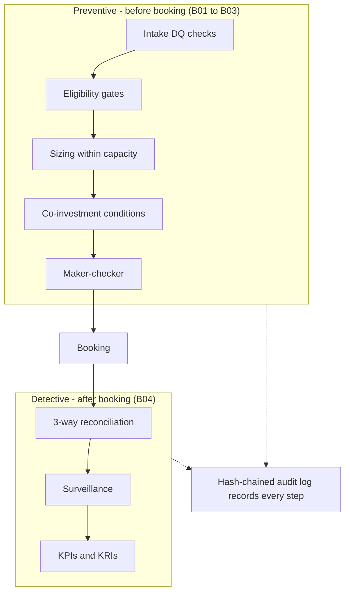
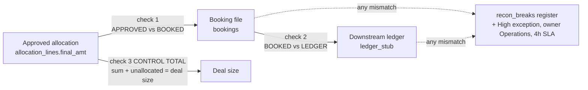
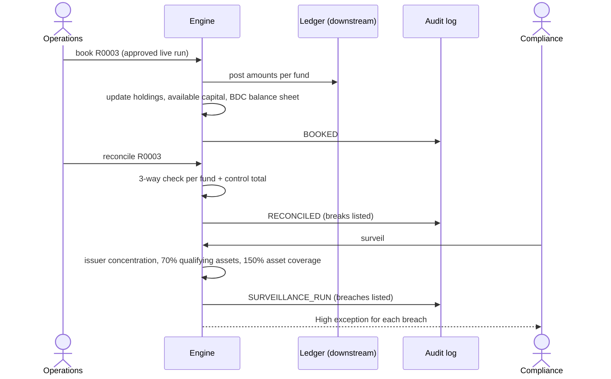

# B04 Guide – Booking, three-way reconciliation, surveillance, KPIs/KRIs, Excel report

**Date:** 19 Oct 2026
**Starting point (B03):** maker-checker, hash-chained audit log, proportional rebalance, promote. 40/40 tests.
**B04 goal:** what happens *after* approval – *"booking support, and post-allocation review"*, *"reconcile allocation inputs and outputs across source systems, models, and downstream records"*, *"allocation surveillance, portfolio reviews, and management reporting"*, *"KRIs, KPIs, service-level metrics"*, plus advanced Excel.

---

## Architecture – preventive vs detective controls



**Design choice:** B01–B03 are **preventive** (stop a bad allocation before it is booked). B04 adds **detective** controls that independently re-check what actually happened downstream. A well-run allocations function needs both – and every step of both lands in the audit log.

## Step 1 – Booking (`ops.book`)
**What:** only an **approved live** run can be booked. Booking:
- writes the booking file (one row per fund with an allocation) and posts to the downstream **ledger stub**;
- updates **holdings** (so future concentration checks see the new exposure), reduces each fund's **available capital**, and updates the BDCs' simplified balance sheet;
- **refuses double booking** of the same deal under another run;
- logs `BOOKED` (including any test injection, so a demo break is never hidden).

**Test hook:** `--inject-break F3:-0.5` or `F3:missing` alters only the *ledger posting*, to prove reconciliation catches it.
**Result:** `R0003 booked: F1=14, F2=5.5, F3=231.5, F4=52, F5=69.5, F6=27.5` (total 400).

## Step 2 – Three-way reconciliation (`ops.reconcile`)



| Check | Compares | Catches |
|---|---|---|
| APPROVED_vs_BOOKED | approved allocation ↔ booking file | booking errors, missing/extra bookings |
| BOOKED_vs_LEDGER | booking file ↔ downstream ledger | posting errors, missing postings |
| CONTROL_TOTAL | Σ allocations + unallocated ↔ deal size | any dollar lost or invented |

Every break → `recon_breaks` register **and** a **High** exception owned by **Operations** with a 4-hour SLA.
**Result (actual):**
```
book --run R0003 --inject-break F3:-0.5
reconcile --run R0003  ->  6 funds x 3 checks -> 1 break
  BREAK B0001 BOOKED_vs_LEDGER fund=F3 expected=231.5 actual=231.0 diff=-0.5 -> High, Operations
```
A second run (D008, no injection) reconciled with **0 breaks**.

## Step 3 – Surveillance (`ops.surveil`)
Portfolio-level checks across all holdings, run independently of any allocation:

| Check | Rule (illustrative) | Why |
|---|---|---|
| Issuer concentration | exposure ÷ NAV ≤ fund's issuer cap | detective re-check of the sizing control |
| BDC qualifying assets | qualifying ÷ total ≥ **70%** | BDC regulatory test from the BCRED 10-K – portfolio level, not per deal |
| BDC asset coverage | total assets ÷ senior securities ≥ **150%** | as above |

**Planted case:** D008 Summit Logistics is flagged `qualifying: false`. Booking it into BDC F2 moves F2 from 70.8% to **69.41%** → **BREACH** → High exception owned by Compliance. Concentration stayed within limits for every fund (e.g. F1 Atlas **4.90%** vs 5% after D003) – the preventive sizing control held, and surveillance proves it.
**Simplification (documented in `data/README.md`):** a booking adds to total assets (and to qualifying assets if the deal qualifies); senior securities unchanged. Real BDC calculations are more involved – this shows the *control*, not the accounting.

## Step 4 – Booking to surveillance end to end



## Step 5 – KPIs and KRIs (`ops.metrics`)

| KPI (performance) | KRI (risk) |
|---|---|
| runs by status; live runs approved or later | % runs with exceptions |
| average create-to-approval time (from the audit log) | open exceptions by severity; overdue (SLA breached) |
| unallocated amount on live runs | approvals that needed an override rationale |
| exceptions resolved or superseded | open reconciliation breaks; surveillance breaches; **audit chain intact** |

**Design choice:** cycle time is computed from audit-log timestamps, so the KPI is evidenced by the same tamper-evident record an auditor would use.

## Step 6 – Excel management report (`ops.export_excel`)
`python -m alloc export --out allocation_report.xlsx` → 7 sheets: **Summary** (KPIs and KRIs), **Allocations**, **Exceptions**, **Reconciliation**, **Surveillance**, **Approvals**, **Audit trail**. Header styling, frozen header row, filters, number formats (USD m, %), sized columns. (`*.xlsx` is git-ignored – generated, never committed.)

## Step 7 – Tests
12 new tests (52 total): only approved live runs book; booking updates holdings, capital and ledger; double booking refused; clean 3-way recon = 0 breaks; injected amount break detected with the right exception; missing ledger posting detected; no recon before booking; surveillance clean after D003; non-qualifying D008 pushes F2 below 70%; asset coverage computed for BDCs; KPIs/KRIs reported (incl. audit chain); Excel has all 7 sheets. Also: superseded hypos now get status `superseded`.
**Result:** **52/52 passed.**
**To commit:** `src/alloc/ops.py`, `src/alloc/__main__.py`, `src/alloc/allocate.py`, `src/alloc/intake.py`, `src/alloc/schema.sql`, `data/deals.json`, `data/fund_portfolio.json`, `data/README.md`, `tests/test_ops.py`, `tests/test_schema.py`, `tests/test_workflow.py`, `docs/SPEC.md`, `docs/B04_GUIDE.md`. Message: `Build 04: booking, three-way reconciliation, surveillance, KPIs/KRIs, Excel report`.

---

## How to run it yourself (≈10 min)
```
python -m alloc load --reset
python -m alloc run --deal D003
python -m alloc rebalance --run R0001
python -m alloc promote --run R0002 --by maker1
python -m alloc submit --run R0003 --by maker1
python -m alloc approve --run R0003 --by checker1
python -m alloc book --run R0003 --by ops1 --inject-break F3:-0.5
python -m alloc reconcile --run R0003                 # 1 break: F3 BOOKED_vs_LEDGER -0.5
python -m alloc run --deal D008 --mode live           # R0004
python -m alloc submit --run R0004 --by maker1
python -m alloc approve --run R0004 --by checker1 --rationale "Board step obtained (illustrative)"
python -m alloc book --run R0004 --by ops1
python -m alloc reconcile --run R0004                 # 0 breaks
python -m alloc surveil                               # F2 qualifying assets 69.41% -> BREACH
python -m alloc metrics
python -m alloc export --out allocation_report.xlsx
python -m alloc audit verify
```

## B04 scorecard
| Item | B03 | B04 |
|---|---|---|
| Lifecycle | up to approval | approval → booking → reconciled |
| Reconciliation | – | 3-way per fund + control total, breaks register |
| Surveillance | – | concentration, 70% qualifying assets, 150% asset coverage |
| Management information | SQL pack | KPIs + KRIs + 7-sheet Excel report |
| Controls | preventive | preventive **and** detective |
| Tests | 40 | 52 |

## Lessons
1. **Preventive controls need detective back-up:** sizing stopped concentration breaches; surveillance *proves* it and catches what sizing can't see (the 70% test depends on the whole portfolio).
2. **Reconcile against an independent record:** the injected break only shows up because the ledger is checked separately from the booking file.
3. **Never hide a test:** the injection is labelled in the CLI output and in the audit log.
4. **Evidence your KPIs:** cycle time from the audit log, not from a manual tracker.

## Next (B05)
- Three mock cases written up as scenarios with real numbers in FINDINGS.md; executive summary.
- README rewrite, architecture overview diagram, ADRs (four separate decisions; preventive vs detective).
- Evidence pack command for one allocation (everything an auditor needs in one place).
