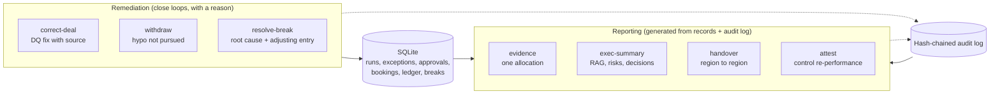
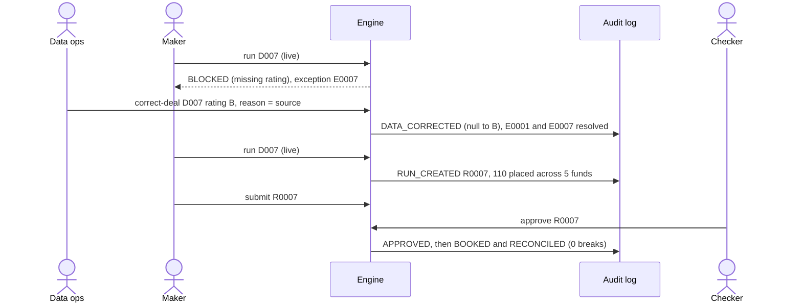
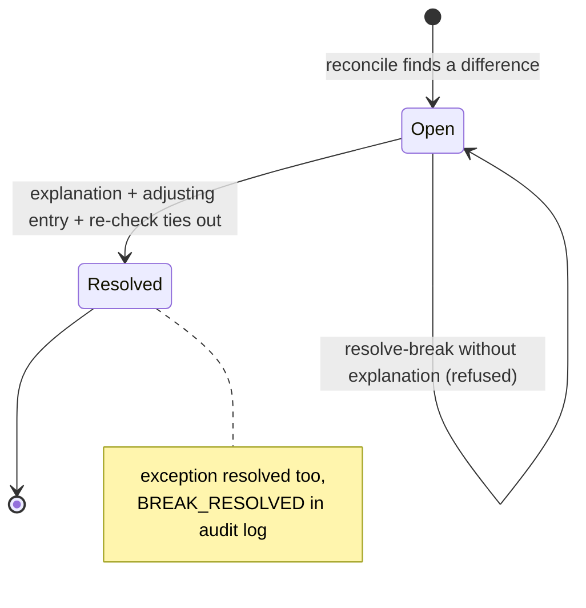
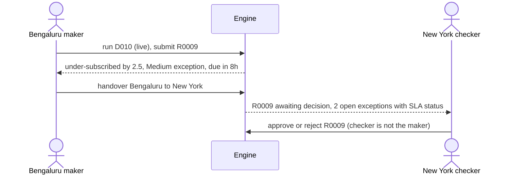

# B05 Guide – Mock cases end to end, evidence pack, exec summary, handover, attestation

**Date:** 19 Oct 2026
**Starting point (B04):** booking, three-way reconciliation, surveillance, KPIs/KRIs, Excel report. 52/52 tests.
**B05 goal:** close every open loop and make the work presentable. An allocations function needs *"complete and readily retrievable evidence"*, *"concise, executive-level updates"*, *"handover and follow-the-sun operating models"* and *"periodic control attestations"*. B05 also runs all mock cases end to end with real numbers and adds the README, ADRs, FINDINGS and RUNBOOK a reviewer will read first.

---

## Architecture – what B05 adds around the pipeline



## Step 1 – Data correction (`correct-deal`)
**Problem from B01–B02:** D007 has no rating. It was loaded, flagged and blocked, but there was no controlled way to fix it.
**What:** `correct-deal --deal D007 --rating B --by data_ops --reason "<source>"`
- rating must be on the scale; a reason is mandatory;
- resolves the open DQ exceptions **for that deal only** (intake exception E0001 and the blocked run's E0007), with the before/after in the resolution;
- marks the blocked run *superseded*;
- logs `DATA_CORRECTED` with before = null, after = B, reason.

To link intake exceptions to their deal, the intake now stores `D007: rating missing…` in the exception's `detail` (small change to `intake.py`).

**D007 from blocked to booked (sequence):**



**Why:** fixing data in place would leave no trace of who changed what and on what evidence. This keeps the "flag, don't silently fix" rule (ADR 0004).

## Step 2 – Closing the other loops
| Gap left by B03–B04 | B05 fix | Command |
|---|---|---|
| The target-weight hypo for D003 kept 2 open Critical exceptions after the rebalance path was chosen, so the exec summary showed **RED** for a hypo nobody was pursuing | Withdraw a hypo with a reason; its exceptions become *Superseded* (live runs can't be withdrawn – a checker must reject them) | `withdraw --run R0002 --by maker1 --reason "..."` |
| A reconciliation break could be raised but not closed | Resolve with a root cause; for a ledger break, post an adjusting entry and **re-check the fund ties out** before closing; its exception is resolved too | `resolve-break --break B0001 --by ops1 --explanation "..."` |

**Break lifecycle:**



`recon_breaks` gets two new columns, `resolved_at` and `resolution` (schema v0.5), and the insert now names its columns so the change can't misalign data.

## Step 3 – Evidence pack (`evidence --run R0004`)
One markdown document per allocation, with seven sections: **deal · run and lineage (R0001 → R0003 → R0004) · policy version · eligibility and sizing per fund · exceptions across the lineage with resolutions · approvals · booking vs ledger and breaks · audit trail for the deal and every run in its lineage · chain verification**.
It also proves the control total: *"Total allocated 400 + unallocated 0 = deal size 400"*.
**Why:** *"readily retrievable evidence"* – one command, no manual assembly from five systems.

## Step 4 – Executive summary (`exec-summary`)
A one-page RAG status built from the metrics:
- **RED** – an open High/Critical exception *and* an open reconciliation break; **AMBER** – either one; **GREEN** – neither.
- Performance, risks and issues, decisions needed (each open High/Critical exception with its owner), capacity per fund.

**Result after the demo:** **AMBER** – one open High (F2 qualifying assets 69.94%, owner Compliance), no open breaks.

## Step 5 – Follow-the-sun handover (`handover --from Bengaluru --to "New York"`)
Lists open exceptions with due time and SLA status (on time / **OVERDUE**), live runs awaiting a decision, and approved runs not yet booked. Ends with a receiving-lead checklist; generating it is logged (`HANDOVER_GENERATED`).



## Step 6 – Control attestation (`attest --period 2026-10 --by cco1`)
Re-performs 8 control tests from the records and shows population, exceptions found and result:
maker ≠ checker · every approved run has an approval record · High/Critical closed only with a written resolution · only approved live runs booked · every booking reconciled · breaks resolved with root cause · no open exception past SLA · audit chain intact.
**Result after the demo:** 8/8 effective. A test that sets one booked run back to unreconciled makes the attestation show **Exception** – it reports failures, it doesn't hide them.

## Step 7 – The demo: five mock cases on one database
`python -m alloc demo` runs, in order (later cases see earlier bookings):

| # | Deal | Key result |
|---|---|---|
| 1 | D003 | Hypos 11.5/8.5 (57:43) → rebalance 14.0/5.5 (72:28), 0 board-step exceptions; target-weight hypo withdrawn; self-approval refused; F3 −0.5 ledger break found and resolved |
| 2 | D009 | F5 excluded (`RESTRICTED_ISSUER`); 90.5 / 39.5 / 53.5 / 21.5 / 15.0 = 220 |
| 3 | D007 | Blocked → corrected to B → 43.0 / 23.0 / 25.5 / 10.0 / 8.5 = 110 |
| 4 | D008 | F2 qualifying assets **69.94%** (pre-trade headroom was $57.7m; allocated $60m) |
| 5 | D010 | Under-subscribed by **$2.5m**; submitted, waiting for New York |

Full write-up, including the recommended pre-trade qualifying-asset check: [FINDINGS.md](FINDINGS.md).
*Note:* B04's walkthrough showed 69.41% for F2 because it booked D008 straight after loading. The demo books D003, D009 and D007 first, so F2 starts from 71.57% and ends at 69.94%.

## Step 8 – Presentation layer
| File | Purpose |
|---|---|
| `README.md` | Architecture diagram, quickstart, mock-case table, responsibility map, limitations, disclaimer |
| `docs/adr/0001–0004` | Four separate decisions · preventive and detective controls · hash-chained audit log · flag, don't silently fix |
| `docs/FINDINGS.md` | Every number from the demo, end-state KPIs/KRIs, limitations and next steps |
| `docs/RUNBOOK.md` | Start of day, per deal, end of day, periodic, BCP, escalation matrix |
| `LICENSE` | MIT |
| `docs/SPEC.md` | v0.5; definition of done: 5 of 8 ticked (remaining: clean-checkout run, git routine, independent review) |

Also: `pandas` removed from dependencies (never used), version 0.5.0, `.gitignore` covers generated reports.

## Step 9 – Tests
11 new tests (63 total) in `tests/test_reports.py`: rating correction resolves DQ, unblocks and is audited; correction needs a reason and a valid rating; another deal's DQ exception is untouched; withdraw supersedes exceptions and refuses live runs; break resolution posts the adjustment, re-reconciles clean and can't run twice; evidence pack sections and control total; evidence pack for D007 shows the correction; exec summary is AMBER with the right action; handover lists the submitted run and is audited; demo numbers end to end; attestation 8/8 and flags an injected violation.
**Result:** **63/63 passed.**

---

## How to run it yourself (≈10 min)
```
python -m alloc load --reset
python -m alloc demo
python -m alloc evidence --run R0004 --out evidence_R0004.md
python -m alloc evidence --run R0007          # D007: look for DATA_CORRECTED
python -m alloc exec-summary
python -m alloc handover --from Bengaluru --to "New York"
python -m alloc attest --period 2026-10 --by cco1
python -m alloc export --out allocation_report.xlsx
python -m alloc audit verify
```
Open `evidence_R0004.md` in VS Code and press Ctrl+Shift+V to see it formatted.

## B05 scorecard
| Item | B04 | B05 |
|---|---|---|
| Mock cases | run individually | 5, end to end on one database, numbers asserted in tests |
| Remediation | – | data correction, hypo withdrawal, break resolution (all with reasons) |
| Evidence on demand | audit trail by entity | evidence pack per allocation |
| Management reporting | KPIs + Excel | + exec summary (RAG), handover, control attestation |
| Documentation | build guides | + README, 4 ADRs, FINDINGS, RUNBOOK, LICENSE |
| Tests | 52 | 63 |

## Lessons
1. **Every open item needs a closing move:** a flag without a resolution path just moves the problem; B05 gives each one (correction, withdrawal, break resolution) and each needs a reason.
2. **Noise erodes trust in MI:** an abandoned hypo turned the exec summary RED. Withdrawing it with a reason fixed the signal without hiding the history.
3. **Run the scenarios in sequence:** case 4's breach and case 5's under-subscription only appear because earlier bookings changed the portfolio – the way a real book behaves.
4. **Write up what the controls missed:** the 70% breach was caught after booking; the finding recommends the pre-trade check rather than claiming the design was complete.

## Next
- Quality gate: independent review against the definition of done, then fixes.
- Go-public checklist (only if it passes and you approve).
- Optional, after the application: pre-trade qualifying-asset headroom check in sizing.
