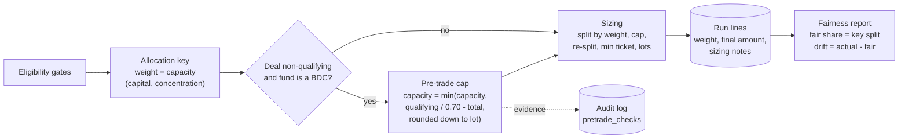
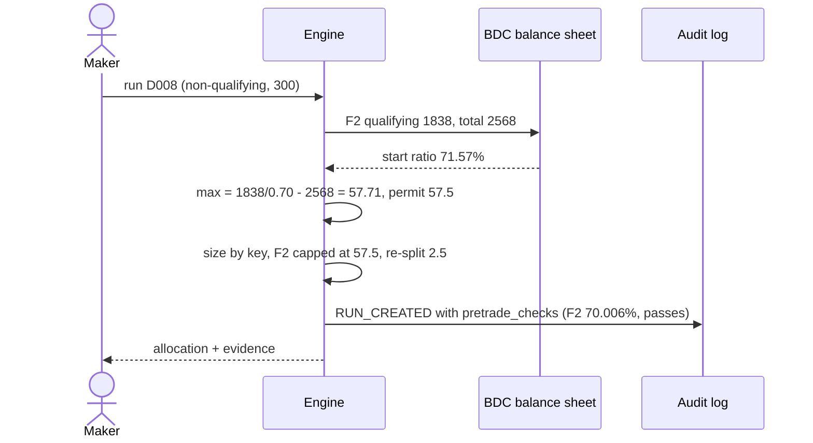
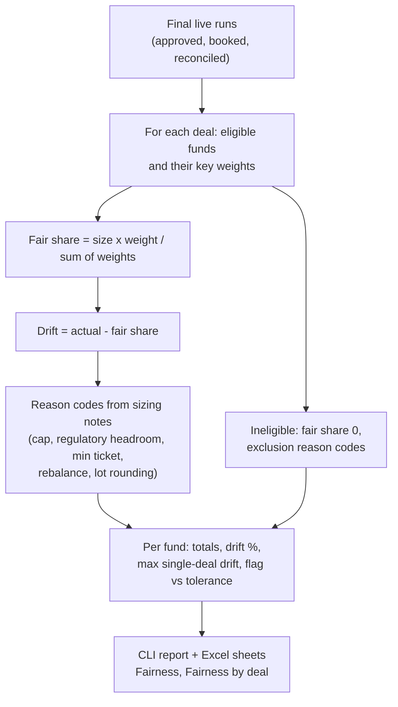

# B06 Guide – Pre-trade BDC qualifying-asset check and allocation fairness report

**Date:** 20 Oct 2026
**Starting point (B05):** five mock cases end to end, evidence pack, exec summary, handover, attestation. 63/63 tests. FINDINGS recorded one control gap: a non-qualifying deal pushed BDC F2 to 69.94% (minimum 70%), caught only by surveillance after booking.
**B06 goal:** (1) close that gap with a **preventive** control, and (2) add the **multi-deal view** an allocations function reports to Compliance: each fund's fair share against what it actually received, across all final allocations, with a reason for every difference. Both are features of the same engine, not a new project.

> Personal prototype. Synthetic data, illustrative policies. The 70% check is an illustrative control under stated assumptions – not legal advice or a production compliance determination.

---

## Architecture – where B06 sits



The cap changes **how much** a fund can take, never its **weight**. So the fund's fair share is unchanged and the cost of the constraint shows up as a reasoned drift (ADR 0005).

## Step 1 – Pre-trade qualifying-asset check (`allocate.qualifying_headroom`)
**Rule:** `SIZE-BDC-QUALIFYING-HEADROOM` v1 (sizing, BDCs, min ratio 0.70). Its note spells out the assumptions.

**Maths:** solve qualifying ÷ (total + x) = 0.70 for x:

```
max_x   = qualifying / 0.70 - total
permit  = max_x rounded DOWN to the 0.5 lot      (down, so the ratio cannot fall below 70%)
capacity = min(capacity, permit)                 (weight unchanged)
```

**Case 4 (D008 Summit, $300m, non-qualifying), F2:**

| Item | Value |
|---|---|
| Qualifying / total before | 1,838 / 2,568 = **71.57%** |
| Maximum non-qualifying purchase | 1,838 / 0.70 − 2,568 = **57.71** |
| Permitted (lot) | **57.5** |
| Key share without the cap | ~60.1 |
| Allocated | **57.5** – cap binding, note `CAPACITY_SET_BY_QUALIFYING_ASSETS_HEADROOM` |
| Ratio after | 1,838 / 2,625.5 = **70.006%** – passes |

At 60 (v0.5) the ratio would be 69.94%; at 58.0 (rounding up) 69.99%. The $2.5m excess is re-split (F1 +1.5, F3 +0.5, F5 +0.5); every dollar is still placed.
**Evidence:** every check (start ratio, maximum, permitted, allocated, ratio after, binding, passes) is written into the `RUN_CREATED` audit entry and shown in the evidence pack (`evidence --run R0008`).
**Detective control kept:** surveillance still runs after booking; a test reclassifies assets after booking and the breach is caught.

**Pre-trade check in the allocation flow (sequence):**



## Step 2 – Allocation fairness report (`reports.fairness`, `python -m alloc fairness`)
**Method (stated in the report, ADR 0005):**
- **Fair share** = deal size × fund's key weight ÷ sum of key weights of the funds that passed every eligibility gate. It is the key split **before** caps, minimum tickets, lot rounding, regulatory caps and rebalancing.
- Ineligible fund → fair share 0, listed as **excluded** with its reason codes.
- **Drift** = actual − fair share, with reason codes from the run's sizing notes; small residuals are labelled `LOT_ROUNDING`; nothing may be `UNEXPLAINED` (tested).
- **Deal set** = live runs approved, booked or reconciled. **Flag** = |drift| > tolerance × fair share (default 5%, illustrative KRI).
- **Control total:** total drift = − unallocated, so the report reconciles to the deals.

**Result (4 final deals, $1,030m):**

| Fund | Fair share | Actual | Drift | Drift % | Main reasons |
|---|---|---|---|---|---|
| F1 | 256.79 | 260.50 | +3.71 | +1.45% | D003 rebalance, re-split from capped F2 |
| **F2** | 131.39 | 125.50 | **−5.89** | **−4.49%** | D003 rebalance (−3.16), **D008 regulatory cap (−2.57)** |
| F3 | 375.07 | 376.50 | +1.43 | +0.38% | rebalance excess, rounding |
| F4 | 110.44 | 110.50 | +0.06 | +0.06% | rounding |
| F5 | 83.92 | 84.50 | +0.58 | +0.70% | 2 deals excluded (restricted issuer; instrument + rating floor) |
| F6 | 72.39 | 72.50 | +0.11 | +0.15% | rounding |
| Total | 1,030.00 | 1,030.00 | 0.00 | | |

**Fairness computation (flow):**



**Excel:** two new sheets. In *Fairness*, Drift, Drift % and the REVIEW/OK flag are **live formulas** driven by a tolerance cell (M1), so a reviewer can change the threshold and see flags update.

## Step 3 – Tests
6 new tests (one replaces the B04 breach test) and 4 updated (68 total):
- pre-trade cap: F2 on D008 straight after load (70.80% start, maximum 28.57, permitted 28.5, ratio after ≥ 70%, no breach after booking); applies only to non-qualifying deals and only to BDCs;
- detective control still catches a breach after a post-trade change;
- demo: F2 57.5, others re-split, total 300, no surveillance breach, exec summary GREEN;
- fairness: drift reconciles to unallocated, every drift has a reason, fair shares add up to deal size, exclusions counted, F2 flagged at a 2% tolerance;
- Excel report has the two new sheets.

**Result:** **68/68 passed.**

## How to run it yourself (≈10 min)
```
python -m alloc load --reset
python -m alloc demo
python -m alloc evidence --run R0008      # see the pre-trade check table
python -m alloc fairness                  # per fund and per deal
python -m alloc fairness --tolerance 0.02 # F2 flagged REVIEW
python -m alloc export --out allocation_report.xlsx   # open Fairness; change M1 and watch the flags
```

## B06 scorecard
| Item | B05 | B06 |
|---|---|---|
| BDC 70% test | detective only (breach at 69.94%) | **preventive + detective** (70.006%, 0 breaches) |
| Fairness across deals | – | per fund and per deal, reason-coded, reconciles to unallocated |
| Excel | 7 sheets | 9 sheets, live formulas on Fairness |
| ADRs | 4 | 5 (fair share and regulatory caps) |
| Tests | 63 | 68 |

## Lessons
1. **Turn a detective finding into a preventive control, and keep the detective one.** The check now stops the breach; surveillance still catches what happens later.
2. **Round in the safe direction.** Rounding the permitted amount down is what guarantees the ratio stays at or above 70%.
3. **Say what "fair" means before measuring it.** The benchmark is the documented key; drift is reported against it, with a reason for every dollar.
4. **Constraints should be visible, not absorbed.** Capping the amount (not the weight) shows the cost of the 70% test to F2's investors.

## Next
- Reserve headroom for live runs that are pending, so two non-qualifying deals in flight can't each use the same headroom.
- Rotation or time-weighted fairness views, if the allocation policy uses them.
