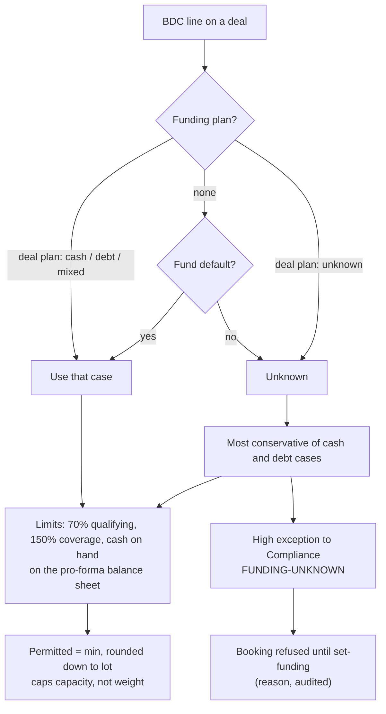
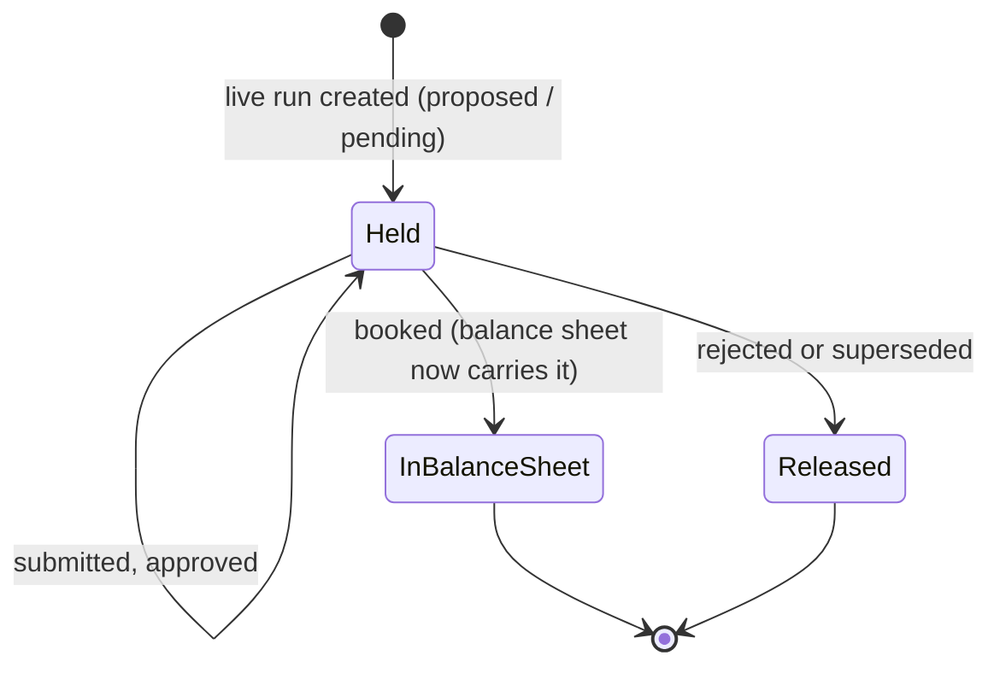
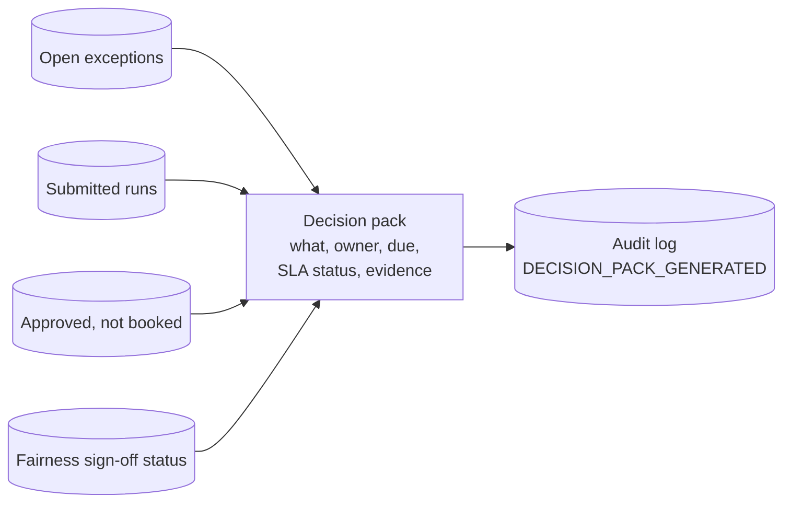
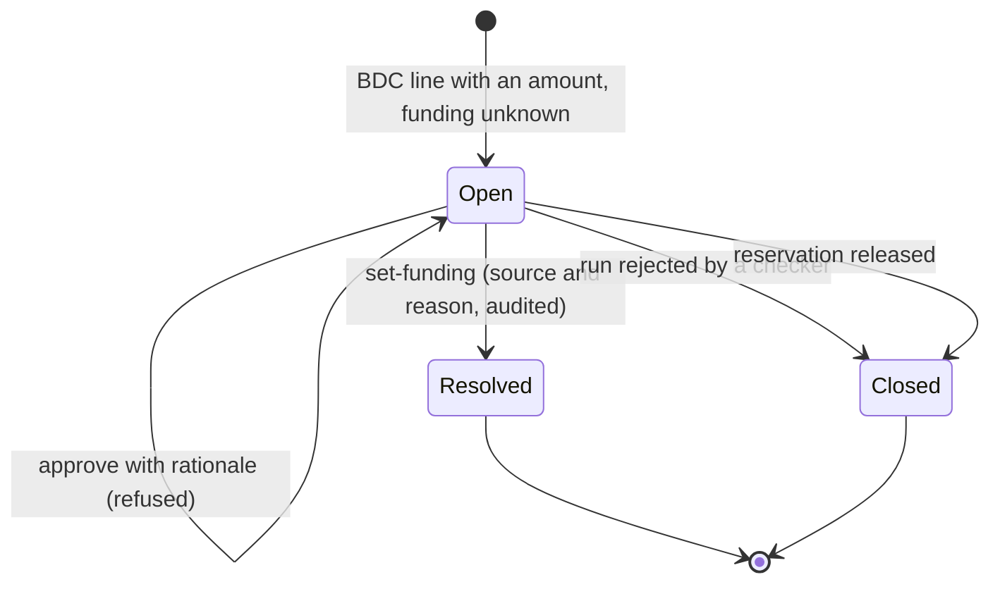
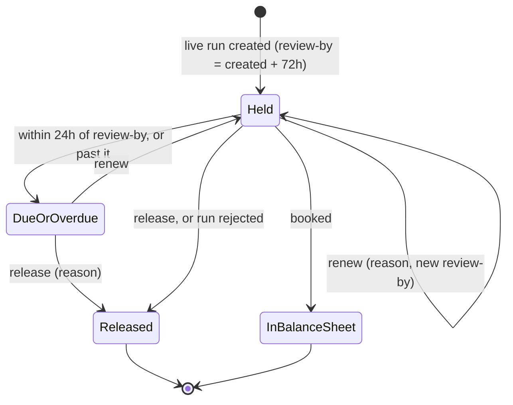

# B07 Guide – Funding-aware headroom, reservations, fairness sign-off, decision pack (+ B07.1 control fixes)

**Date:** 20 Oct 2026
**Starting point (B06):** pre-trade BDC 70% cap and fairness report. 68/68 tests.
**Review finding that triggered B07:** the B06 cap assumed every purchase is **debt-funded**. A cash-funded purchase gives a different (tighter) limit, debt also affects the 150% asset-coverage test, and two deals in flight could each use the same headroom.
**B07 goal:** make the control judgement explicit – model the funding, take the safe case when an input is missing and make someone accountable, reserve what pending deals have already been promised, and give reviewers and operators a clear sign-off and decision view.

> Personal prototype. Synthetic data. The regulatory logic is an illustrative control under stated assumptions – not legal advice or a production compliance determination; classification and calculation basis must be validated with authoritative guidance and the fund's Legal/Compliance teams.

---

## Step 1 – Funding-aware headroom (`bdc.py`)

**Balance sheet per BDC:** Q qualifying assets (cash assumed inside), T total assets, S senior securities, C cash.
**Buying x with cash share c** (0 = all debt, 1 = all cash): cash part lowers C and Q; debt part raises T and S; the loan adds to Q only if it is qualifying.

| Test | Debt-funded (c = 0) | Cash-funded (c = 1) | Mixed (share c) |
|---|---|---|---|
| 70% qualifying (non-qualifying deal) | x ≤ Q / 0.70 − T | x ≤ Q − 0.70 T | x ≤ (Q − 0.70 T) / (c + 0.70 (1 − c)) |
| 150% asset coverage | x ≤ (T − 1.5 S) / 0.5 | no effect | x ≤ (T − 1.5 S) / (0.5 (1 − c)) |
| Cash on hand | no effect | x ≤ C | x ≤ C / c |

Permitted = smallest limit, rounded **down** to the 0.5 lot.

**Funding source:** deal plan (`funding_plans`) → else fund default → else **unknown**. Unknown → apply the **most conservative** of the cash and debt cases (that minimum is within the limit for any mix) and raise a **High exception to Compliance** (`FUNDING-UNKNOWN`). Booking is refused until `set-funding` records the confirmed source with a reason (audited; resolves the exception).

**D008, F2 (debt-funded):** 70% limit 57.71, coverage limit 132 → **57.5**; ratio after 70.006%, coverage 152.2%. If F2 had paid cash: 1,838 − 0.70 × 2,568 = **40.4 → 40.0**. If unknown: 40.0 and an exception.



## Step 2 – Reservations for pending runs
Live runs that are **proposed, pending escalation, submitted or approved** (not yet booked) hold:
- **capital** – free capital = available capital − reserved;
- **issuer exposure** – concentration headroom also deducts pending allocations to the same issuer;
- **BDC headroom** – the pro-forma balance sheet applies their purchases (with their funding) before the next deal is checked.

**Lifecycle:**



**Case 6 (D013, run while D008 is approved, not booked):** F2's pro-forma ratio is already 70.006% → permitted **0**; F1's free capital is 152.5 − 113 = 39.5; F1's funding for D013 is unknown → conservative case + exception. Without reservations F2 could have been sized at 57.5 again against the same headroom. `python -m alloc reservations` shows what is held, per BDC, booked vs pro forma.

**Pre-booking re-check:** at booking, the engine re-projects each BDC's ratios with the confirmed funding; if the balance sheet moved since sizing and a test would fail, the booking is refused and nothing is written (tested).

## Step 3 – Fairness: policy version, sign-off, commentary
- The report lists the **deal set** (run IDs) and the **policy version(s)** in force.
- `fairness-signoff --by <reviewer> [--tolerance] [--comment F2="..."]` stores reviewer, time, tolerance, deal set, policy versions, flagged funds, commentary and a SHA-256 hash of the report.
- **Segregation:** a reviewer who created any run in the set is refused. **Commentary** is mandatory for every fund over tolerance.
- The **control attestation** now has a 9th test: the current final deal set is signed off.

## Step 4 – Operator decision pack (`python -m alloc decisions`)
One table of every decision waiting – **what, owner, due time, SLA status, evidence command, context** – built from open exceptions, submitted runs (owner: a checker who is not the maker), approved-but-unbooked runs (Operations) and an unsigned fairness report (Compliance reviewer). Sorted by deadline; overdue items marked.



**Demo end state:** 4 decisions – confirm D013 funding (Compliance), approve or reject D013 and D010 (checker, not maker1), accept or fill D010's $58.5m shortfall (Allocations VP).

## Step 5 – Tests
7 new tests (one replaces a B06 test) and 5 updated (74 total): funding maths for cash, debt and mixed against the formulas; unknown funding → conservative case, High exception, booking blocked, `set-funding` unblocks; pending runs reserve headroom and capital and release on rejection; pre-booking re-check refuses a stale allocation; checks run for BDCs only (coverage also on qualifying deals); fairness sign-off segregation and commentary; decision pack contents; demo numbers for cases 4 and 6; attestation 9/9.
**Result:** **74/74 passed.**

## How to run it yourself (≈10 min)
```
python -m alloc load --reset
python -m alloc demo
python -m alloc evidence --run R0008      # D008: funding, scenarios, permitted, ratios after
python -m alloc evidence --run R0009      # D013: reserved by R0008, F1 unknown funding, F2 permitted 0
python -m alloc reservations
python -m alloc decisions
python -m alloc fairness --tolerance 0.02
python -m alloc fairness-signoff --by maker1 --tolerance 0.02                       # REFUSED: segregation
python -m alloc fairness-signoff --by cco2 --tolerance 0.02                         # REFUSED: commentary for F2
python -m alloc fairness-signoff --by cco2 --tolerance 0.02 --comment F2="D003 rebalance and D008 70% cap, both documented"
python -m alloc set-funding --deal D013 --fund F1 --source debt --by treasury1 --reason "facility draw confirmed (illustrative)"
python -m alloc decisions                 # the funding decision is gone
```

## B07 scorecard
| Item | B06 | B07 |
|---|---|---|
| Funding | assumed debt | cash / debt / mixed / unknown, with the case shown |
| Tests per BDC | 70% | 70%, 150% coverage, cash on hand |
| Missing input | – | conservative case + High exception + booking blocked |
| Deals in flight | each saw the booked balance sheet only | capital, issuer exposure and headroom reserved |
| Booking | no re-check | pre-booking re-check |
| Fairness | report | + policy version, sign-off with segregation and commentary |
| Operator view | exec summary, handover | + decision pack |
| ADRs / tests | 5 / 68 | 6 / 74 |

## B07.1 – Control fixes after review (20 Oct 2026)

**Review finding:** three controls could look closed while they were not – unknown funding was not always visible and could be cleared by an approval rationale; a fairness sign-off stayed "current" if the run IDs matched, even with a different tolerance, policy or figures; reservations had no owner or end date. Decision record: ADR 0007.

### Fix 1 – Unknown funding is a visible hard stop
- `FUNDING-UNKNOWN` (High, Compliance) is raised for **every BDC line with an amount** and unknown funding – qualifying or not, binding or not, and on every path (run, rebalance, promote). Before, a qualifying deal with a non-binding cap raised nothing, yet booking would refuse it.
- `approve` **refuses** while it is open, with or without a rationale. It closes only by `set-funding`, or by **rejecting** the run or **releasing** its reservation (both close the run's open exceptions with the reason).
- Attestation tests 10 and 11: no hard stop closed any other way; no BDC line booked on unknown funding.



### Fix 2 – Fairness sign-off bound to what was reviewed
A sign-off is valid only while **run set, tolerance, policy versions and the SHA-256 of the canonical report** (all figures, sorted-key JSON) all match the report as it stands. `decisions`, `fairness` and `attest` (test 9) say which one changed. The review tolerance is now policy (`CTRL-REVIEW` v1, 5%).

| Change after FS001 | Sign-off |
|---|---|
| None | valid |
| Review at 2% instead of 5% | not valid – tolerance changed |
| A final amount corrected by 0.5 (same run IDs) | not valid – report content changed (hash) |
| A run's policy version differs | not valid – policy versions changed |
| A new final run | not valid – run set changed (+R…) |

### Fix 3 – Reservation aging
Every live, unbooked run shows **owner (maker), amount held, age and review-by** (created + 72h) in `decisions` and `reservations`. Due within 24h or overdue → a **"renew or release"** decision for the owner. Past the date the run **still holds** capacity – it is escalated, never freed silently.
- `reservation-renew --run R --by --reason [--hours ≤72]` → new review-by; audited `RESERVATION_RENEWED`.
- `reservation-release --run R --by --reason` → run `released`, capital and headroom freed, open exceptions closed; for an approved run, not by its maker; audited `RESERVATION_RELEASED`.



### Fix 4 – Approval SLA
`submit` sets `approval_due_at` = submitted + 8h (`CTRL-REVIEW`). The decision pack uses it as the due time; attestation test 12 flags overdue approvals; test 13 flags reservations past review-by.

### Tests and result
6 new tests, 2 updated (80 total): hard stop raised for a qualifying, non-binding line; approval refused, rejection closes it, a closure by rationale is caught by the attestation; sign-off invalidated by tolerance, content and policy changes and valid again when restored or re-signed; approval SLA; renew/release with limits, segregation and audit; nothing freed at review-by. Attestation now **13/13**. **80/80 passed.**

```
python -m alloc load --reset
python -m alloc demo
python -m alloc approve --run R0009 --by checker1 --rationale "ok"     # REFUSED: hard stop E0010
python -m alloc decisions                                              # reservations table, approval SLAs
python -m alloc decisions --days-ahead 4                               # preview: renew-or-release decisions OVERDUE
python -m alloc reservation-renew --run R0009 --by maker1 --reason "close moved (illustrative)" --hours 48
python -m alloc fairness --tolerance 0.02                              # sign-off NOT VALID: tolerance changed
python -m alloc attest --period 2026-10 --by cco1                      # 13 tests
```

## Lessons
1. **State the hidden assumption.** The B06 formula was right only for debt funding; naming the funding made the control correct for cash too.
2. **When an input is missing, take the safe case and make someone accountable** – don't guess.
3. **Pending is not free.** Anything already promised to a deal in flight must be reserved before the next deal is sized.
4. **A report needs an owner.** Sign-off with segregation and commentary turns a fairness number into a reviewed control.
5. **(B07.1) A block must be visible before it bites, and cannot be approved away.** Closing an exception should mean the underlying fact changed.
6. **(B07.1) Bind a sign-off to what was reviewed** – content hash, parameters and policy – not to an identifier.
7. **(B07.1) Never free capacity silently.** Give every reservation an owner and a date, and make release a named decision.
