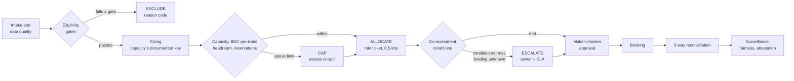

# Decision path – why the engine allocates, caps, excludes or escalates

> Personal prototype. Synthetic data; illustrative policies modelled on public filings (listed under **Sources**). The BDC checks are a **model under stated assumptions** – not legal advice and not a production regulatory control; they would need validation by the fund's Legal and Compliance teams before any real use.

Every deal follows the same path. Each step can only do one of four things to a fund's share, and each outcome carries a reason code, an owner and evidence.

**Trace any run:** `python -m alloc trace --run R0008` (add `--fund F2` for one fund) prints, per fund, the gates passed or failed, the capacity and what set it, the key share, every cap or adjustment with its reason in plain English, the BDC pre-trade check (funding, scenario, permitted, ratio after), the final amount and outcome; then the exceptions across the run's lineage, the approval, booking and reconciliation, and the audit-chain check. It is read-only and built from the same stored records as the evidence pack. Each rule it uses is listed with its basis (public statute, public filing, illustrative mandate term or prototype design choice), its assumption, its sources and who would have to approve it in practice – from [data/rule_sources.json](../data/rule_sources.json). Generated samples: [docs/samples](samples).

## 1. The steps, their inputs and assumptions

| Step | Inputs | Rule (illustrative) | Can only… |
|---|---|---|---|
| Intake and data quality | deal terms, rating, issuer | structural errors rejected; business gaps (e.g. missing rating) loaded but blocked | block until corrected with a sourced reason |
| Eligibility gates | fund mandate, instrument, rating floor, sector, restricted list | a fund that fails any gate gets nothing | **exclude** |
| Sizing | available capital, issuer-concentration headroom, documented allocation key | capacity = min(available capital, issuer cap × NAV − existing exposure); split by the key; minimum ticket; round down to 0.5 lots | **allocate** |
| Pre-trade BDC headroom | BDC balance sheet (simplified, book value), asset classification, funding plan, live unbooked runs | 70% qualifying-asset and 150% asset-coverage tests after the deal, under the fund's funding plan; capital and headroom already reserved by approved-not-booked runs are deducted | **cap** (excess re-split to other eligible funds) |
| Co-investment conditions | existing holdings of affiliated funds, proposed shares | same terms; where an affiliate already holds the issuer, regulated funds participate in approximate proportion or a board step is needed | **escalate** – never changes amounts by itself |
| Approval | run, exceptions | maker ≠ checker (code and database); High/Critical exceptions need a recorded rationale; **hard stops** (unknown funding) cannot be approved away | approve, reject or hold |
| Booking and reconciliation | booking file, ledger | approved vs booked vs ledger, plus control total | raise a break with owner and SLA |
| Surveillance, fairness, attestation | booked portfolio, all final runs | portfolio limits re-tested; fair share vs actual per fund with reason codes; sign-off bound to run set, tolerance, policy versions and report hash | flag for review, re-sign |

**Stated assumptions:** single currency; holdings at issuer level ("same security" approximated by "same issuer"); simplified book-value BDC balance sheet; cash treated as a qualifying asset; illustrative asset classifications; escalation owners and SLAs from `data/escalation.json` (Critical: CCO / board, 1 hour; High: Allocations VP + CCO, 4 hours).

## 2. Four outcomes, four scenarios

| Outcome | Scenario | What happens and why | Trace it |
|---|---|---|---|
| **Exclude** | D009 Crescent, $220m | The issuer is on the restricted list for the insurance mandate (F5) only. F5 fails the gate (`RESTRICTED_ISSUER`) and gets 0; the other five funds are allocated and the deal reconciles clean. | `python -m alloc trace --run R0005 --fund F5` |
| **Cap** | D008 Summit, $300m | A non-qualifying loan into a debt-funded BDC (F2). Its key share (~60) would take it to 69.94% qualifying assets, below 70%. The debt-case limit is 57.71, rounded down to the lot: **57.5**, leaving F2 at 70.006%. The 2.5 excess is re-split. Had F2 paid cash, the limit would be 40.0. | `python -m alloc trace --run R0008 --fund F2` |
| **Escalate** | D003 Atlas, $400m | Two BDCs already hold the issuer at 72:28 but would take 57:43, outside approximate proportion. Two Critical exceptions go to the CCO / board. A proportional rebalance (14.0 / 5.5) clears them. | `python -m alloc trace --run R0004` |
| **Escalate (hard stop)** | D013 Orion, $120m | D008 is approved but not booked, so its reservation leaves F2 with zero headroom. F1's funding is unknown, so it is sized on the most conservative case and a High exception goes to Compliance. Approval is refused until funding is confirmed, or the run is rejected or released. | `python -m alloc trace --run R0009` |

Run IDs are those created by `python -m alloc load --reset` followed by `python -m alloc demo`. `python -m alloc evidence --run <id>` gives the full audit evidence for the same run.

Reading the outcome order matters: an exclusion is decided before sizing, a cap only ever reduces a share, and a condition only ever escalates. That keeps each decision explainable to the person who owns it.

## 3. Sources (public)

The regulatory logic is modelled on these public sources. They are cited as the basis for illustrative rules, not as a statement of any firm's policy. Rule-by-rule provenance, including the version of each rule, is in [data/rule_sources.json](../data/rule_sources.json).

| Topic | Source |
|---|---|
| 70% qualifying assets | Investment Company Act of 1940, section 55(a) – [15 U.S.C. 80a-54](https://www.law.cornell.edu/uscode/text/15/80a-54) |
| Asset coverage | Sections 18 and 61(a) – [15 U.S.C. 80a-60](https://www.law.cornell.edu/uscode/text/15/80a-60): 200% by default; 150% only if the section 61(a)(2) conditions, including the required approval, are met. **Assumption:** both synthetic BDCs have met them – recorded per fund in [data/fund_portfolio.json](../data/fund_portfolio.json) |
| Transactions with affiliates | Section 57 – [15 U.S.C. 80a-56](https://www.law.cornell.edu/uscode/text/15/80a-56) |
| Co-investment conditions | [Form 40-APP/A, Amendment No. 2, 24 Apr 2025, SEC file 812-15726](https://www.sec.gov/Archives/edgar/data/1803498/000119312525093651/d934153d40appa.htm) – conditions 1 (same class, time and price; settlement up to ten business days later), 2 (existing investment: approximate proportion, otherwise the section 57(f) steps) and 5 (fair and equitable allocation) |
| Co-investment order | [SEC Release IC-35644, 18 Jun 2025](https://www.sec.gov/files/rules/ic/2025/ic-35644.pdf), under sections 17(d) and 57(i) and rule 17d-1 |
| Allocation practice | [FY2025 annual report (Form 10-K) of a large non-traded BDC](https://www.sec.gov/Archives/edgar/data/1803498/000180349826000014/bcred-20251231.htm) – allocation policies "generally provide for sharing pro rata based on targeted acquisition size"; using each fund's capacity as its targeted size is this prototype's assumption |

Classification, the calculation basis and the conditions of any specific exemptive order would need confirming against the authoritative text and by Legal and Compliance.
